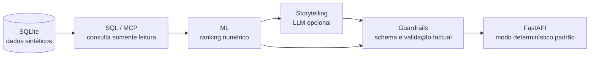

# AgenteFinanceiroBradesco

> **Projeto educacional desenvolvido no bootcamp da DIO. Não é um produto oficial do Bradesco e usa apenas dados 100% sintéticos. Nunca use dados reais de clientes.**

Este projeto demonstra um fluxo de priorização de transações para revisão humana. Consultas SQL/MCP fornecem dados a uma etapa de ranking numérico; uma etapa opcional de storytelling pode produzir um relatório estruturado, sujeito a guardrails antes de ser exposto pela API. O modo padrão é determinístico e não chama um provedor de LLM.

## Arquitetura



O relatório é uma ajuda à revisão, não uma decisão automatizada. Quando o LLM está habilitado, sua saída ainda precisa passar pela validação; uma falha resulta em uma nova tentativa e, se necessário, no relatório determinístico degradado.

## Requisitos

- Python 3.11 (validado com a versão 3.11.9).
- Windows PowerShell nos exemplos abaixo; adapte os comandos de ativação para o seu shell.
- Para execução real com LLM: credencial autorizada do provedor configurada localmente. O fluxo `--dry-run` e a API determinística não precisam dessa credencial.

## Instalação e execução

Crie e ative um ambiente virtual e instale as dependências:

```powershell
python -m venv .venv
.\.venv\Scripts\Activate.ps1
python -m pip install -r requirements.txt
```

Crie a base sintética padrão em `data/transacoes.db` somente se ela ainda não existir:

```powershell
if (-not (Test-Path .\data\transacoes.db)) {
    python -m src.utils.db_gen
} else {
    Write-Error "A base já existe; preserve-a ou faça backup antes de regenerar."
}
```

> **Atenção:** executar `python -m src.utils.db_gen` diretamente recria as tabelas da base indicada e substitui os dados existentes. Os arquivos `data/*.db` são ignorados pelo Git e não são distribuídos no repositório.

Gere um relatório determinístico, sem inicializar MCP ou LLM:

```powershell
python -m src.crew.main --dry-run
```

### Exemplo de saída

Trecho abreviado de uma execução local do comando acima (resumos encurtados):

```json
{
  "casos": [
    {"id_transacao": 3540, "posicao": 1, "resumo": "Prioridade de revisão; PIX web no Rio de Janeiro; R$ 5.616,46 ..."},
    {"id_transacao": 988, "posicao": 2, "resumo": "Prioridade de revisão; PIX app no Rio de Janeiro; R$ 15.172,14 ..."},
    {"id_transacao": 4682, "posicao": 3, "resumo": "Prioridade de revisão; PIX app em São Paulo; R$ 1.586,02 ..."}
  ],
  "degradado": false
}
```

Configure o arquivo `.env` a partir de [.env.example](./.env.example). Não versione `.env` nem compartilhe chaves. Inicie a API:

```powershell
python -m uvicorn src.api.app:app --host 127.0.0.1 --port 8000
```

`GET /health` verifica a disponibilidade. `POST /analisar` exige o cabeçalho `X-API-Key` e aceita, por exemplo, `{"top_n":10,"use_llm":false}`. A chave de acesso da API é distinta da chave do provedor. Para integrar um front-end, consulte [Integração com Lovable](#integração-com-lovable).

Execute os testes offline:

```powershell
python -m unittest discover -s tests -v
```

Para a comparação experimental com Hugging Face, as dependências são opcionais:

```powershell
python -m pip install -r requirements-hf.txt
```

## Configuração

| Variável | Finalidade | Comportamento padrão / observação |
|---|---|---|
| `DATABASE_URL` | Caminho/URL do banco SQLite | Usa a base sintética local padrão; bancos existentes são preservados na inicialização da API. |
| `API_ACCESS_KEY` | Autenticação de `POST /analisar` | Sem configuração, a análise fica indisponível. Gere uma chave forte e mantenha-a fora do código e do navegador. |
| `CORS_ORIGINS` | Origens permitidas para CORS | Lista JSON de origens exatas; padrão vazio. Não use wildcard em produção. |
| `ALLOW_LLM` | Permite opt-in de chamadas ao LLM pela API | `false`; requer também `use_llm=true` na requisição para habilitar. |
| `GEMINI_API_KEY` | Credencial do provedor Gemini | Necessária somente para execução real com o provedor; nunca publique. |
| `LLM_MODEL` | Modelo configurado para a integração | Necessário somente com LLM habilitado; disponibilidade e geração real dependem do provedor. |
| `LLM_MAX_CALLS_PER_MINUTE` | Limite de chamadas LLM por processo | Padrão `5`; não é um limite global entre múltiplas réplicas. |
| `LLM_TIMEOUT_SECONDS` | Prazo da execução LLM | Padrão `60` segundos; valor máximo `300`. |

Os nomes acima são variáveis, não valores de credenciais. Consulte `.env.example` para o formato esperado, sem inserir segredos em arquivos versionados.

## Resultados experimentais — Fase 3

| Configuração | PR-AUC | Precisão@100 |
|---|---:|---:|
| Apenas variáveis numéricas | 0,775 | 25,0% ± 0,00 p.p. |
| Numéricas + texto com Hugging Face | 0,733 | 25,2% ± 0,84 p.p. |
| Numéricas + TF-IDF | 0,557 | 20,6% ± 0,55 p.p. |

Esses resultados são exploratórios: a base é sintética e o gerador foi ajustado após a observação de resultados preliminares, portanto não representam uma avaliação independente nem eficácia em dados reais. As diferenças de precisão@100 entre numéricas e Hugging Face estão dentro do ruído observado; o texto não demonstrou ganho consistente. TF-IDF teve resultado inferior nesta configuração. Não extrapole essas métricas para operações reais.

## Guardrails e limitações

- Schemas Pydantic estritos rejeitam campos extras e campos obrigatórios ausentes.
- IDs do relatório são conferidos contra o banco e contra o conjunto retornado pela ferramenta, incluindo o limite solicitado de resultados.
- Valores, datas, cidades e números citados precisam ser sustentados pelos dados disponíveis à ferramenta.
- A saída deve respeitar os campos, fatores e restrições de linguagem definidos para o relatório. São proibidas afirmações de probabilidade, “chance de fraude”, percentuais associados a fraude, “fraude confirmada” e referências a `rotulos_fraude`. A redação usa “prioridade de revisão” e “suspeita”.
- Se a geração falhar na validação, há uma tentativa de correção; se ela também falhar, retorna-se o relatório determinístico validado com `degradado=true`.
- Os scores são heurísticos e **não são probabilidades**. O ranking considera a base inteira disponível; não é uma avaliação temporal nem uma medida de desempenho em produção.
- A execução real do LLM não está validada por um relatório bem-sucedido: a tentativa mais recente com `gemini-3.8-flash` terminou em HTTP 504, sem relatório. A API e o modo determinístico foram testados separadamente.
- A chave CORS limita origens de navegador, mas não substitui autenticação, autorização, TLS ou controles de abuso. O limite LLM é por processo; trabalhos em thread que atinjam timeout podem continuar até o timeout do SDK.

Não use este projeto para decisões financeiras reais ou para tratar qualquer transação como fraude confirmada.

## Integração com Lovable

A aplicação Lovable precisa alcançar uma **URL pública** da API, fornecida por uma hospedagem ou por um túnel de desenvolvimento. Configure `CORS_ORIGINS` com a origem exata do front-end e envie `X-API-Key` nas chamadas a `POST /analisar`.

Não coloque `API_ACCESS_KEY` em código de front-end: uma chave embutida no navegador pode ser extraída. Para uma integração pública, use um backend/proxy sob seu controle para guardar a chave e encaminhar as chamadas. HTTPS, gestão de segredos e controles de acesso são responsabilidade do ambiente de hospedagem.

## Estrutura do repositório

```text
config/         configuração de agentes e tarefas
docs/           especificação e guias do projeto
mcp_servers/    servidor MCP SQLite (`sqlite_server.py`)
src/
  api/          API FastAPI
  crew/         fluxo de agentes, relatório e guardrails
  ml/           ranking/modelo de anomalias transacionais
  utils/        geração da base sintética
tests/          testes offline e de integração simulada
data/           base SQLite local, gerada e não versionada
```

## Próximos passos

- Repetir a execução real do LLM quando o provedor estiver estável e houver autorização explícita; avaliar o relatório completo, não apenas a conectividade.
- Fazer avaliação com protocolo independente e congelado antes de qualquer ajuste do gerador ou dos modelos.
- Antes de uma implantação pública, configurar URL/TLS, segredos no servidor, proxy para o Lovable, controles globais de taxa e monitoramento operacional.
